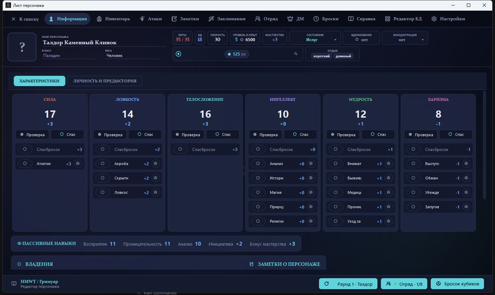
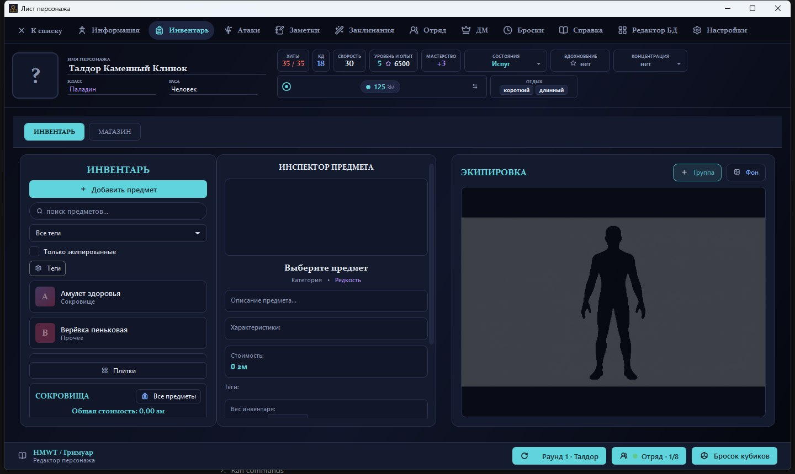
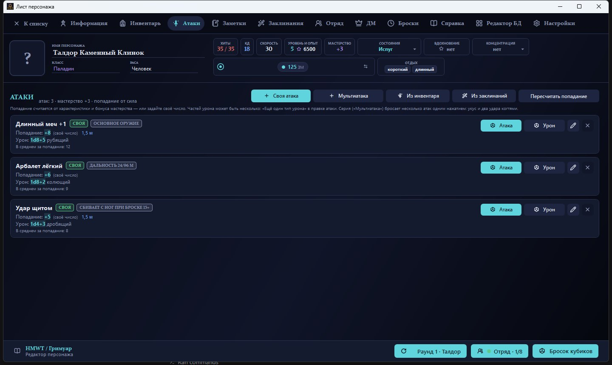
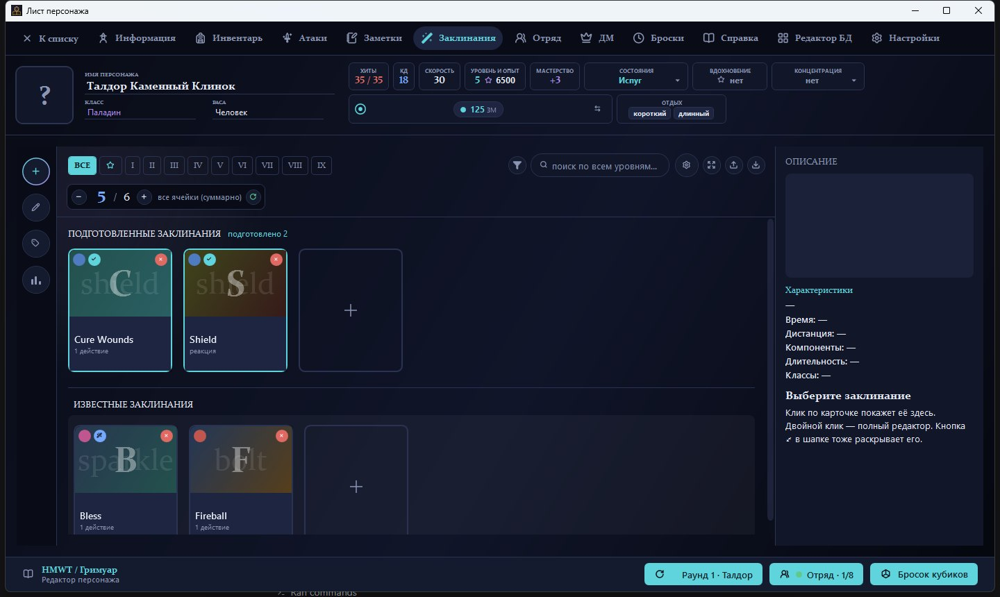
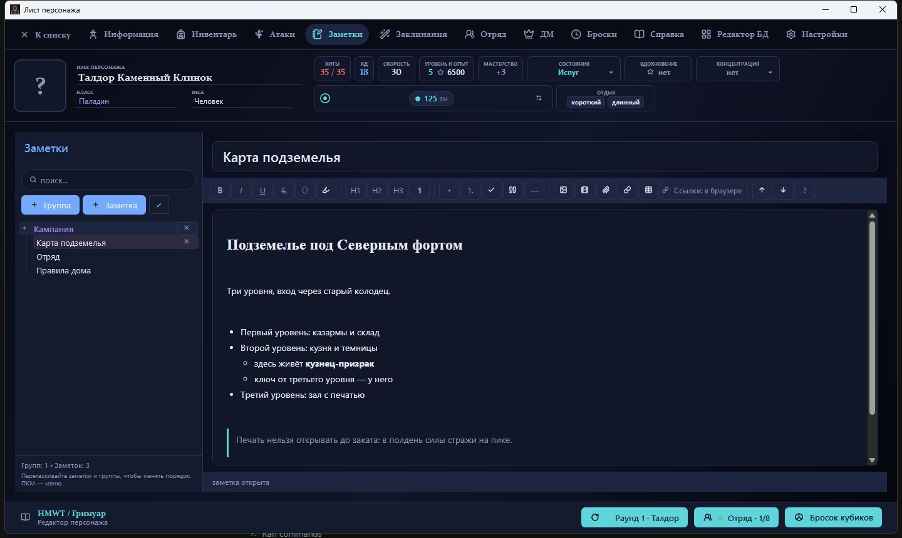
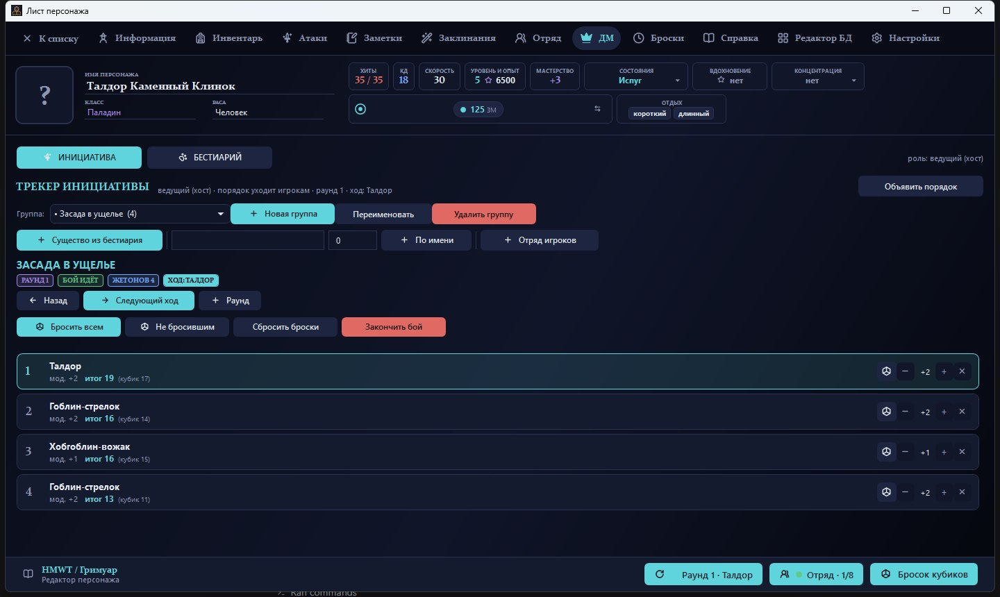
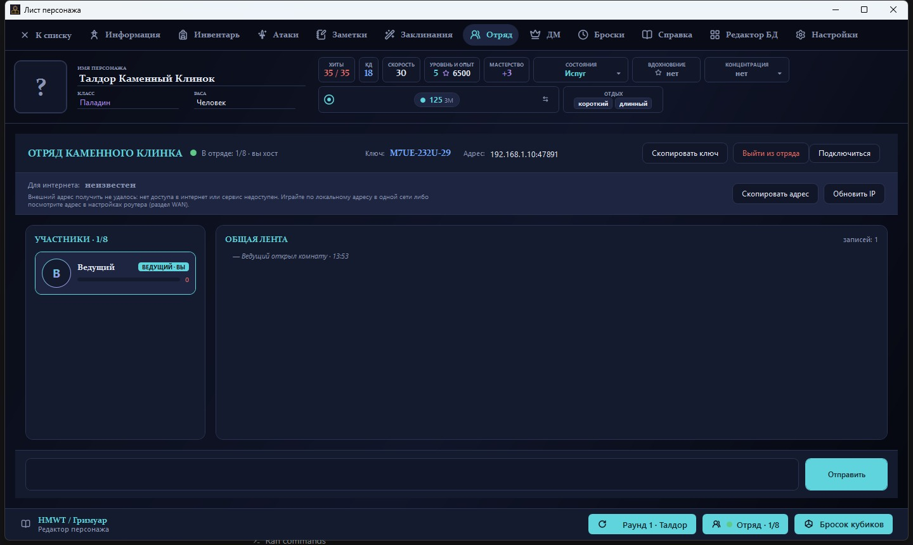

# HMWT Гримуар

Редактор персонажа и инструменты ведущего для настольных ролевых игр.
Windows, WPF, .NET Framework 4.8.

## Скриншоты

Лист персонажа: характеристики и навыки, хиты, отдых, состояния.



| | |
|---|---|
|  |  |
|  |  |
|  |  |

## Возможности

- **Лист персонажа** — характеристики, навыки, спасброски, владения, предыстории,
  опыт и уровень, здоровье и стабилизация.
- **Инвентарь** — предметы, экипировка, вес и деньги, торговля, свои предметы,
  фотографии для карточки и для списка.
- **Заклинания** — ячейки и подготовка, школы, урон с добавкой за уровень выше,
  несколько типов урона в одном заклинании, свои заклинания.
- **Атаки** — попадание и урон, несколько частей урона, приёмы и мультиатака.
- **Заметки** — дерево папок, гиперссылки, картинки и гифки.
- **Отряд** — общая комната до 8 человек: состояние персонажей, броски кубиков
  и лента событий.
- **Инструменты ведущего** — трекер инициативы и бестиарий со статблоками,
  живые формулы броска прямо в тексте карточки.

## Установка

1. Скачайте установщик из раздела **Releases** и запустите его.
2. Нужен Windows 10/11 и .NET Framework 4.8.
3. Вкладке «Заметки» нужен компонент **Microsoft Edge WebView2 Runtime**:
   в Windows 11 он уже есть, в Windows 10 обычно приходит с обновлениями.
   Если его нет, установщик после установки предупредит и даст ссылку —
   без него заметки открываются, но текст в них не правится.

Данные и фотографии хранятся в `%APPDATA%\HMWT` и при обновлении не теряются.

## Сборка

Путь к MSBuild зависит от выпуска Visual Studio: у 18 это `Insiders`, у 17 —
`Community`/`Professional`/`Enterprise`. Надёжнее спросить у системы:

```powershell
$msbuild = & "${env:ProgramFiles(x86)}\Microsoft Visual Studio\Installer\vswhere.exe" `
    -latest -products * -requires Microsoft.Component.MSBuild `
    -find "MSBuild\**\Bin\MSBuild.exe" | Select-Object -First 1

& $msbuild HMWT_MUI\HMWT_MUI.csproj /p:Configuration=Release /p:Platform=x64
```

Если vswhere недоступен, подойдёт путь напрямую, например
`C:\Program Files\Microsoft Visual Studio\18\Insiders\MSBuild\Current\Bin\MSBuild.exe`.

Собираются обе конфигурации: `Release` и `Debug` (в `Debug` включаются
дополнительные проверки отрисовки иконок).

Проект старого формата: `dotnet build` его не собирает. Новый файл исходника
нужно добавить в `HMWT_MUI\HMWT_MUI.csproj` тегом `<Compile Include="..." />`.

Установщик:

```powershell
powershell -NoProfile -ExecutionPolicy Bypass -File installer\build-installer.ps1
```

Нужен Inno Setup. Готовый файл появится в `installer\Output`.

## Справочники

Тексты правил в поставку не входят: справочник подключает сам игрок из открытой
базы 5e SRD — той же, что лежит в основе сайта [dnd5eapi.co](https://www.dnd5eapi.co/)
([репозиторий 5e-bits/5e-srd-api](https://github.com/5e-bits/5e-srd-api)).
Импорт сделан именно под файлы `5e-SRD-*.json` из этой базы.

### Как подключить

1. Скачайте базу: на странице репозитория **Code → Download ZIP**.
2. Распакуйте в любое место, например `C:\HMWT\srd`.
3. В программе: окно персонажа → вкладка **Настройки** → раздел
   **Справочники SRD** → кнопка **Импортировать из папки…**.
4. Укажите папку нужного языка — она лежит внутри `packages\5e-database\src`:

| Папка | Что из неё приходит |
|---|---|
| `src\2024\ru` | русский SRD 5.2: предметы, виды, классы, умения, предыстории, правила, состояния |
| `src\2024\en` | английский SRD 5.2: то же плюс заклинания, магические предметы и чудовища |
| `src\2014\en` | английский SRD 5.1: предметы, заклинания, магические предметы, правила, расы |
| `src\2014\ru` | русский SRD 5.1: только списки — школы магии, навыки, состояния, языки |

Английские и русскую папки можно подключить вместе: заклинания различаются по
языку, а предметы и статьи просто помечаются разными книгами.

### Что куда попадает

| Файлы базы | Где это видно в программе |
|---|---|
| `Equipment`, `Magic-Items` | каталог предметов: инвентарь и торговля |
| `Spells` | вкладка заклинаний |
| `Backgrounds` | выбор предыстории в листе персонажа — раздел «Личность и предыстории» |
| `Races`, `Species`, `Subraces`, `Subspecies`, `Classes`, `Subclasses`, `Feats`, `Features`, `Traits`, `Levels`, `Conditions`, `Poisons`, `Rules`, `Skills`, `Languages`, `Magic-Schools`, `Damage-Types`, `Alignments`, `Ability-Scores`, `Proficiencies`, `Weapon-Properties`, `Weapon-Mastery-Properties`, `Equipment-Categories` | вкладка **Справка**: разделы слева, поиск и список статей в середине, текст справа |

Разделы на вкладке строятся по тому, что реально импортировано: пустых не бывает.

Предыстории с уже знакомым названием не перезаписываются: встроенные можно
править под свою игру, и импорт добавляет только те, которых в списке нет.

Чего в базе нет: **русского перевода заклинаний, магических предметов и
чудовищ**, а также **раздела с божествами** — богов в SRD нет вообще.

### Если переведено не всё

Перевод SRD сделан частично, но это не беда: вторую базу можно **дополнить
первой**. Рядом с кнопкой импорта есть **«Дополнить другой базой…»** — она
добавляет только то, чего не хватает, и ничего не перезаписывает. Записи
сопоставляются по внутреннему ключу `index`, который от языка не зависит.

Порядок такой:

1. Импортируйте русскую базу: `src\2024\ru`.
2. Нажмите «Дополнить другой базой…» и укажите `src\2024\en`.

Что получится на этих двух папках:

| | Всего | По-русски | По-английски |
|---|---|---|---|
| Предметы | 443 | 182 | 261 |
| Заклинания | 339 | — | 339 |
| Статьи справочника | 885 | 885 | — |

То есть русское остаётся русским, а пробелы закрываются английским: в списке
предметов рядом стоят «Длинный меч» и «Bag of Holding», а заклинания приходят
целиком на английском, потому что перевода нет вовсе. Дополнять можно в любом
порядке и повторно — лишнего не появится.

### Что импорт не затрагивает

Справочник только добавляет записи, всё своё остаётся на месте:

- свои предметы и заклинания, созданные вручную, не перезаписываются;
- пакет HMWT (экспорт и импорт персонажа) работает как раньше — справочник
  в него не попадает;
- повторный импорт обновляет записи по названию и книге, дубли не появляются;
- удалить импортированное можно там же, где и свои записи.

## Авторы

Основной автор — **Arbopas**.

**XERNUSHKIN** — поддержка проекта, тестирование и макеты вкладки заклинаний.
Не является автором кода и правообладателем. Подробнее — в [CREDITS.md](CREDITS.md).

## Поддержка

Проект бесплатный: без рекламы, платных версий и подписок. Если хочется
поддержать разработку — можно [на Boosty](https://boosty.to/arbopas).
Это добровольно и ничего не открывает в программе.

## Лицензия

Код распространяется по **GNU Affero General Public License v3.0 only**
(AGPL-3.0-only) — см. [LICENSE](LICENSE).

Версии до 1.2.8.15 остаются под MIT: их уже нельзя отозвать, но новые
версии идут под AGPL.

Название **HMWT Гримуар**, логотип и обозначение **Help Me With That** не
входят в лицензию кода. Правила для форков — в [TRADEMARKS.md](TRADEMARKS.md).

Исходники: [github.com/ARBOPAS/HMWT_WPF](https://github.com/ARBOPAS/HMWT_WPF).
Сторонние компоненты и их лицензии — в [THIRD_PARTY_NOTICES.md](THIRD_PARTY_NOTICES.md).

Справочные тексты в поставку не включены. Если вы подключаете их у себя, помните
об источнике: SRD 5.1 и 5.2 выпущены Wizards of the Coast под
[CC-BY-4.0](https://creativecommons.org/licenses/by/4.0/) — их разрешено
распространять и изменять при указании авторства, — а сама база 5e-database
распространяется под MIT (Adrian Padua, Christopher Ward). Программа показывает
источник рядом со статьёй и не выдаёт эти тексты за свои.

Проект не связан с Wizards of the Coast и не одобрен ими. «Dungeons & Dragons»
и связанные названия принадлежат их правообладателям.

